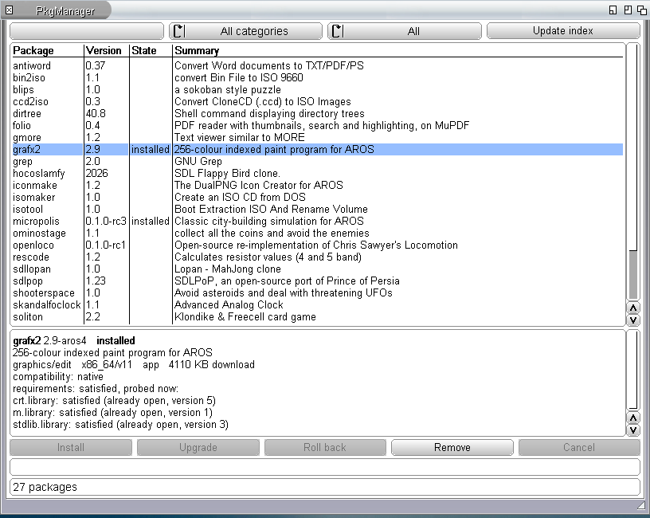
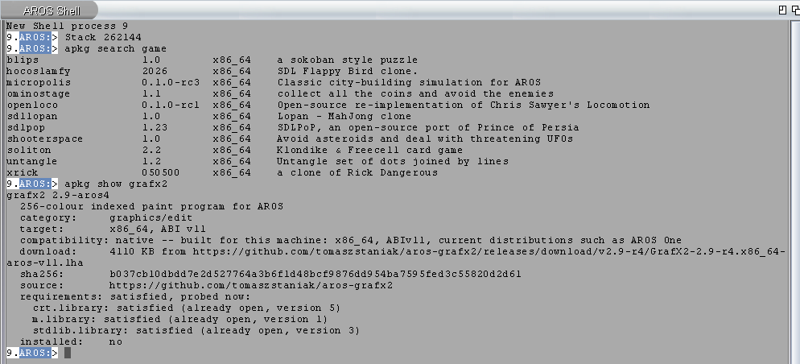
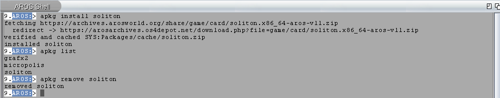

# arospkg

Find, install and remove AROS software from a window or the Shell.
**PkgManager** is the graphical interface; **apkg** is the command-line tool.
Both use the same catalogue and installed packages.

## Downloads

**[Download 0.6.0 for AROS (x86_64, ABIv11)](https://github.com/tomaszstaniak/arospkg/releases/download/v0.6.0/arospkg-0.6.0.x86_64-aros-v11.zip)**
· [Release notes](https://github.com/tomaszstaniak/arospkg/releases/tag/v0.6.0)
· [i386 ABIv0](https://github.com/tomaszstaniak/arospkg/releases/download/v0.6.0/arospkg-0.6.0.i386-aros-v0.zip)
· [Mainline x86_64 ABIv1 (experimental)](https://github.com/tomaszstaniak/arospkg/releases/download/v0.6.0/arospkg-0.6.0.x86_64-aros-v1.zip)
· [Raspberry Pi 0.5.0 (experimental, untested on a Pi)](https://github.com/tomaszstaniak/arospkg/releases/download/v0.5.0/arospkg-0.5.0.aarch64-aros-raspi.zip)

New in 0.6.0: packages can **depend on** other packages, recommend, conflict with and replace them, and `apkg install` shows the plan before it changes anything. One file in a package may be up to 128 MiB, so larger programs install, and test releases are put in order for `apkg upgrade` (0.9.0-test2-r2, 0.9.0-test4, 0.9.0). `apkg update` says what is new, `apkg recent` lists recent additions, and `apkg show` and PkgManager say whether a build was reviewed and where it was tested. Some catalogue entries need 0.6: earlier versions do not see them. On 0.4.x and 0.5.x, `apkg self-update` installs the new apkg; PkgManager comes from the archive.

[Screenshots of 0.5.0 on AROS One](docs/screenshots/0.5.0/README.md) ·
[0.4.2 screenshots](docs/screenshots/0.4.2/README.md).

The mainline archive includes apkg and PkgManager. There is no 0.6.0 Raspberry Pi build; 0.5.0 remains its latest.

## Install

1. Download and unpack the ZIP for **your CPU and ABI**. If upgrading, close PkgManager
   and wait for any apkg operation to finish.
2. Open a Shell and use `CD` to enter the unpacked drawer.
3. Run these commands to put `apkg` on the command path and
   fetch the software catalogue:

```text
Copy apkg C:
apkg --version
apkg update
```

`apkg --version` should report the version and ABI of your chosen archive.
No compiler, Installer script or separate TLS libraries are needed.

Keep the extracted drawer somewhere permanent, not `RAM:`, if using
PkgManager (included in the ABIv11, mainline and Pi archives). Installing
packages requires a working network connection.

**Upgrading from 0.3.x?** Install 0.6.0 manually using the commands above.
Keep `SYS:Packages`; it contains your installed programs and package records.

## Use the graphical interface

From the extracted arospkg drawer, start:

```text
Run PkgManager
```

Click **Update index** to refresh the catalogue, select an application,
read its requirements and click **Install**. To uninstall it later, select
it and click **Remove**.

The line above the list shows when the catalogue was last updated and how
many installed programs have updates. Choose **Updates (N)** in the state
selector to see only those. For an installed package the Version column
shows the installed version and, where there is a newer one, what it would
become (`1.0 -> 1.1`); the details say the same and give the reason when an
update is blocked. Select one and click **Upgrade** to see its plan and confirm.
`Run PkgManager --updates` opens the window on that list.

Select an installed package and click **Run** to start it, or **Open
folder** to see its drawer (the default location is `SYS:Packages/<id>/`).
**Verify** checks its files. Run is offered for packages that say how they
start; the details say how, or why not.



## Use the Shell

For example, find and install the Soliton card game:

```text
apkg search soliton
apkg show soliton
apkg install soliton
```

`show` displays the description, compatibility and requirements before
you download anything. After installation apkg prints where the program
is and the command that opens its drawer in Wanderer:

```text
apkg open soliton
```

| Command | What it does |
|---|---|
| `apkg update` | Refresh the available-software catalogue and say how many installed programs have updates; does not upgrade them. |
| `apkg outdated` | List installed programs with updates: installed and available version, and whether the update can be installed now. |
| `apkg search` | List available packages. Add a word to search. |
| `apkg list` | List installed packages. |
| `apkg verify soliton` | Check installed files against the package record. |
| `apkg remove soliton` | Remove the package, keeping locally changed files and files it did not install. |
| `apkg upgrade soliton` | Install a newer version or packaging revision, when available. |
| `apkg upgrade --all` | Show the plan, then upgrade every package that can be, one at a time, reporting each. |
| `apkg rollback soliton` | Return to the previous revision, if its archive is still cached. |
| `apkg run folio [file]` | Start an installed application as its package describes; `--check` says whether and how. |
| `apkg open soliton` | Open the package's drawer in Wanderer. |
| `apkg self-update` | Replace this apkg with the latest stable release; `--check` only reports. |

From 0.4.0, use `apkg self-update --check` to check for a newer stable
release and `apkg self-update` to install it. The previous executable is
kept as `apkg.old`. Update PkgManager separately from the release archive.

Both interfaces use `SYS:Packages` by default. For another location, pass
the **same root to both**, every time:

```text
apkg --root Work:Packages update
apkg --root Work:Packages install soliton
Run PkgManager --root Work:Packages
```

This selects a separate package root; it does not move existing installs.

Use `apkg --help` for common commands and `apkg --help-all` for the full
list. `apkg --about` shows project and licence information; PkgManager has
an **About** button.

### If a download fails

Check that the system has a working network connection and that
`ENV:SYS/Certificates/ca-bundle.crt` exists. Certificate checks are
required; do not disable them.
If `show` reports a CPU or ABI mismatch, choose a build for your system.

## For application authors

You build your program as usual. `apkg-pack` describes the built drawer
once, checks it and packs it into a ZIP that apkg installs. Upload the ZIP
where you normally publish, then submit its URL to the catalogue:

```text
python3 apkg-pack.pyz init build/MyApp
python3 apkg-pack.pyz check build/MyApp
python3 apkg-pack.pyz build build/MyApp --output myapp-1.0.x86_64-aros-v11.zip
python3 apkg-pack.pyz submit <download-url> --pr
```

[Download apkg-pack.pyz](https://github.com/tomaszstaniak/arospkg/releases/download/apkg-pack-v0.1.0/apkg-pack.pyz)
and run it with Python 3.11 or later on macOS, Linux or Windows; AROS
support is experimental. Your sources
can stay private, and packing needs no GitHub account or network. It packs,
it does not compile, and its checks do not test the program on AROS. Read
the [authoring guide](docs/guide/authoring.md).

## What it looks like



Installing and removing a package from AROS Archives:



PkgManager does the same from a window, and shows the plan of an upgrade
or a rollback before it runs. The screenshots are from AROS One 1.3 under
QEMU, with the published catalogue.

## Documentation

Start at [`docs/README.md`](docs/README.md):

- [using arospkg](docs/guide/using.md): install, open, update, remove,
  in one page;
- [publishing your program](docs/guide/authoring.md): describe, check,
  pack and submit with `apkg-pack`;
- [packaging guide](docs/guide/packaging.md): from a program's drawer to an
  approved index entry, tested on AROS;
- [metadata reference](docs/guide/metadata.md): every field, and who
  checks it;
- RFCs: the [embedded package manifest](docs/rfc/0001-package-format.md)
  (proposal), the [application folder format](docs/rfc/0002-application-folder.md)
  (implemented: how `apkg run` starts a program) and
  [storefront metadata](docs/rfc/0003-storefront-metadata.md) (proposal; the
  0.5.0 pictures and Demo store demonstrate it);
- [ARexx interface](docs/arexx.md);
- [release notes](https://github.com/tomaszstaniak/arospkg/releases)
  for changes and known limitations.

## Layout

- `src/`: `libpkg/` (all the logic), `pkg/` (`apkg`), `pkgmanager/`
  (`PkgManager`).
- `tools/`: host scripts that import the AROS Archives catalogue, check
  archives and generate the index.
- `index/`: locally generated candidates, excluded from Git and the public catalogue.
  Approved manifests and the index are in arospkg-index.
- `tests/`: host unit tests, the scripts run on AROS, and pinned fixtures.
- `examples/arexx/`: ARexx scripts for PkgManager.
- `release/`: the README and licences shipped in the release archive.
- `assets/source/demo-store/`: source images and metadata for the GUI demonstration.

## Building

You need an x86_64 AROS cross toolchain for ABIv11 (GCC 10.5 was used) and
the matching SDK with `libz.static.a`. The default build uses vendored
Mbed TLS 3.6.7 and jitterentropy 3.7.0. `TLS=openssl` selects an alternative
backend; the 0.4.0 release uses Mbed TLS.

```
TC=/path/to/toolchain SDK=/path/to/sdk sh src/build.sh       # apkg
TC=/path/to/toolchain SDK=/path/to/sdk sh src/build-gui.sh   # PkgManager
```

`src/build-gui-mainline.sh` and `src/build-gui-raspi.sh` build PkgManager
for mainline and the Pi. `tools/make-demo-store.py` builds the demo
storefront that the archives ship in `Demo/`.

`src/build-mainline.sh`, `src/build-i386.sh`, `src/build-aarch64.sh`
(hosted) and `src/build-raspi.sh` (native Raspberry Pi) build other targets
with their matching SDKs and toolchains. Mainline and the Pi build
use system `getentropy()`. Check the release notes for each target's
test coverage.

The 0.6.0 archives were made from the release commit with
`README=release/README TARGETS="x86_64-aros-v11 i386-aros-v0 x86_64-aros-v1" sh tools/make-rc.sh 0.6.0`.
Despite its name, this script packages stable releases too; without
`TARGETS` it builds all four targets and needs all four toolchains.
`tools/make-release.sh` is the older packaging path, not the release recipe.

The published release descriptions are kept in `release/notes-<version>.md`
([0.6.0](release/notes-0.6.0.md), [0.5.0](release/notes-0.5.0.md), [0.4.2](release/notes-0.4.2.md), [0.4.1](release/notes-0.4.1.md), [0.4.0](release/notes-0.4.0.md)). Update that file when adding
builds, then use it for the GitHub release notes.

`tests/run-host-tests.sh` runs the unit tests on the host: ZIP, LHA,
SHA-256, the upgrade planner, the ARexx parser, the index generator and the
documentation examples. It needs a C compiler, Python 3 and `lha` (lhasa).

The tests on AROS (`tests/*.script`, `tests/arexx/`, `tests/show/`) run on
AROS One under QEMU. The shell scripts that drive them were written for our
own test machines and will need adapting elsewhere. Test coverage is
summarised in the release notes. Historical run records remain available
in earlier Git revisions; local reports and work notes are not part of
the current public tree.

## Licence

MIT, see [`LICENSE`](LICENSE). The archives include the licences for
Mbed TLS, jitterentropy (except mainline), zlib and the AROS XTerm
terminal-control client.
