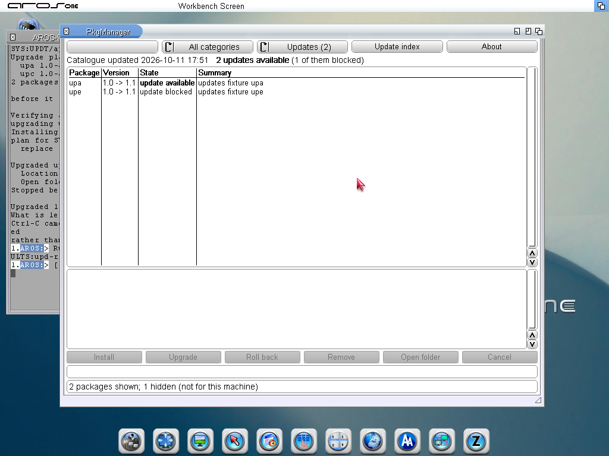
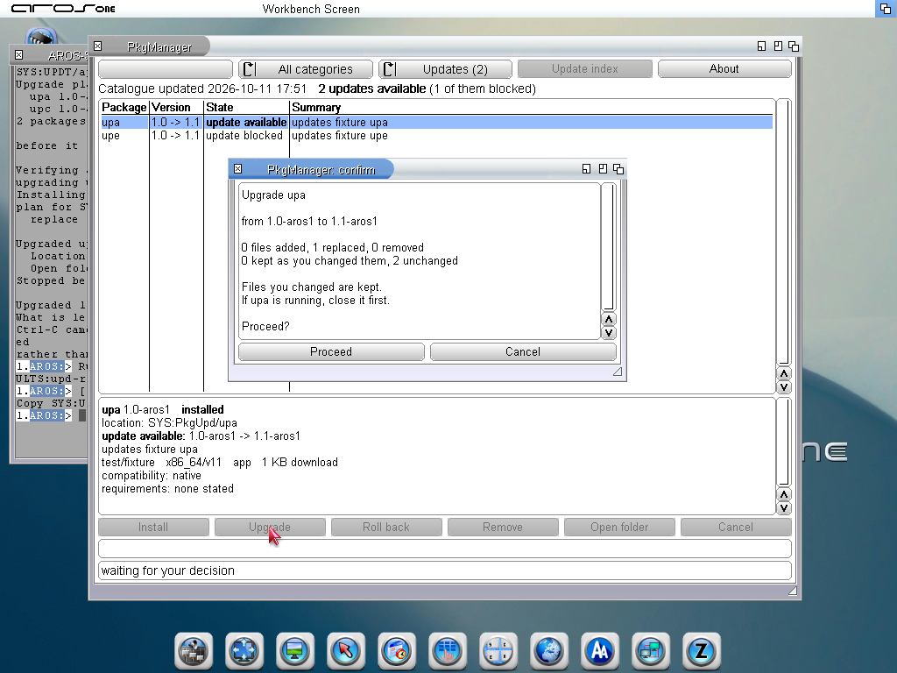
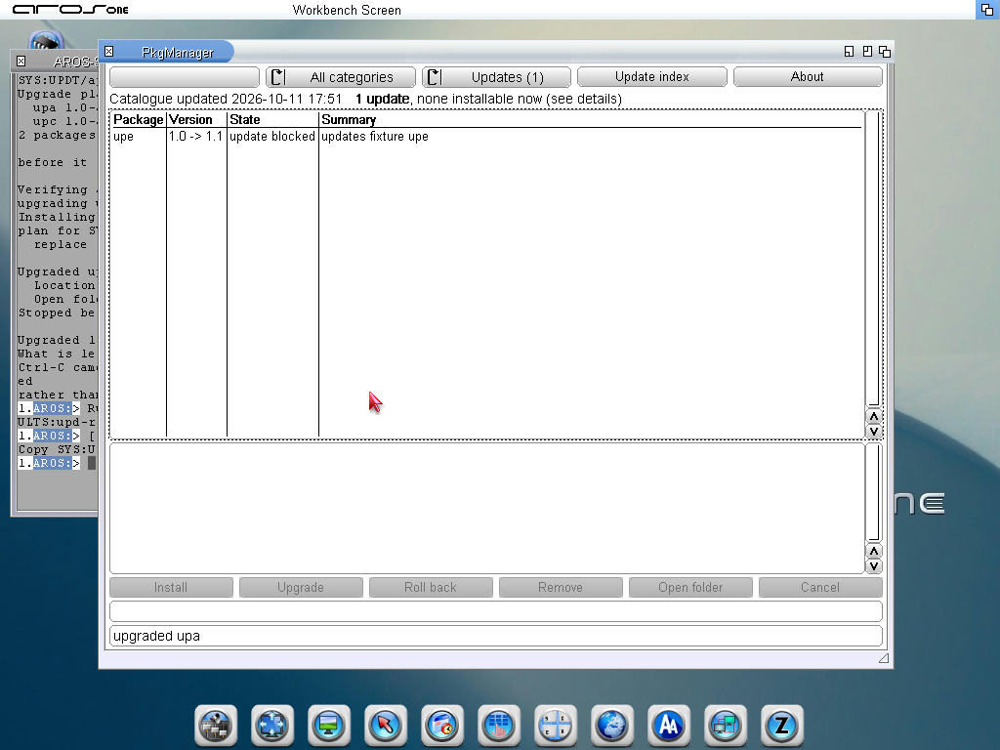
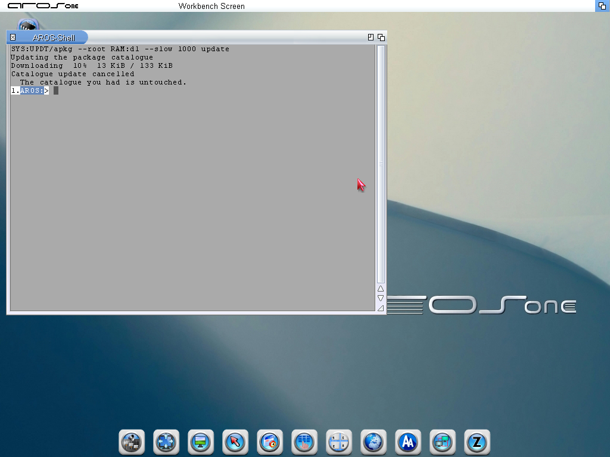
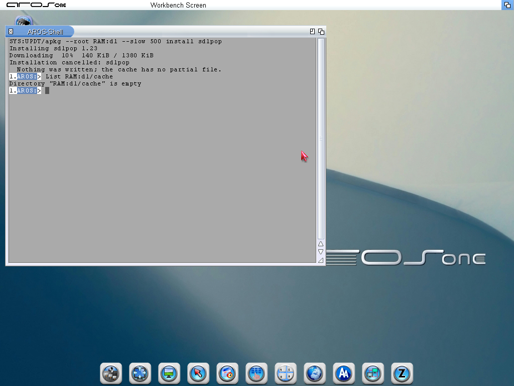
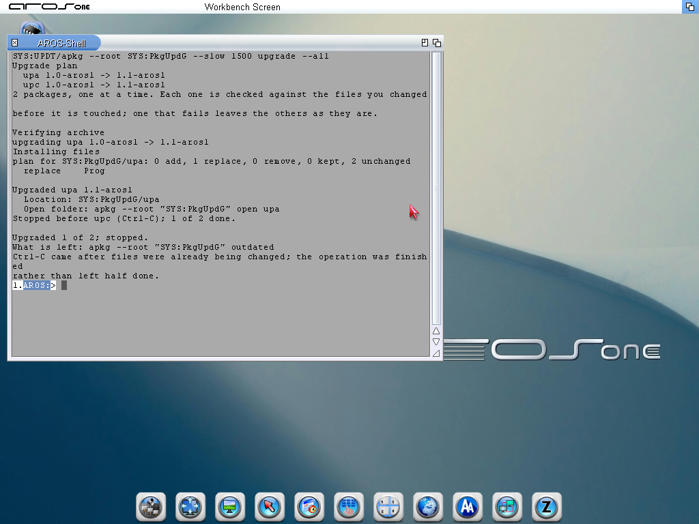

# arospkg 0.4.2 screenshots

AROS One 1.3, x86_64 ABIv11, QEMU slot v11-1, 2026-10-11. These are
unaltered captures from the final run using the binaries built at release tag
v0.4.2 (bbefb2f). Package names upa/upe are controlled test fixtures used to
show available and blocked updates. They are not public applications.

## Updates filter and installed → available versions

## Upgrade preview and confirmation

## Refreshed list after an upgrade

## Cancel catalogue download

## Cancel package download

## Stop a group after finishing the current transaction

Source logs and original names: [release test evidence](../../evidence/2026-10-11-updates/README.md).
ScreenBar/PkgUpdates is an internal demonstration, not a dependency or release requirement.
