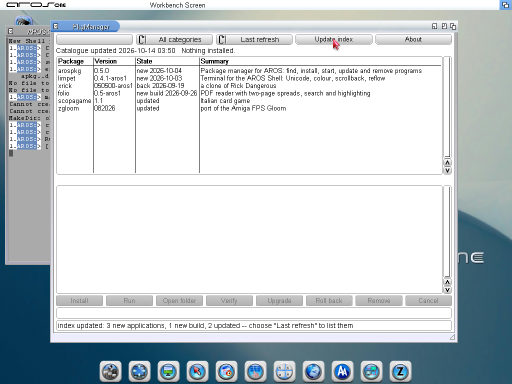
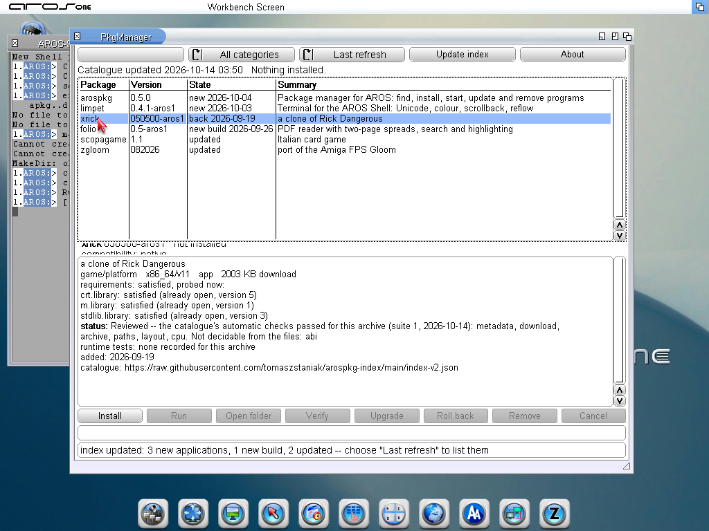
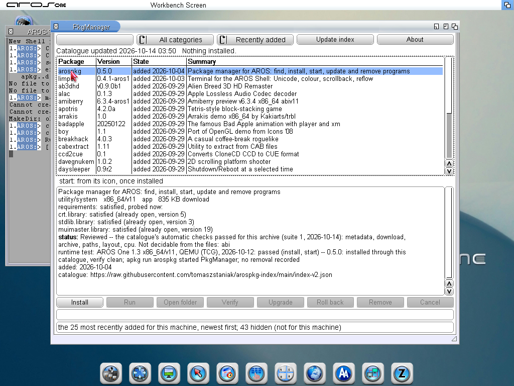
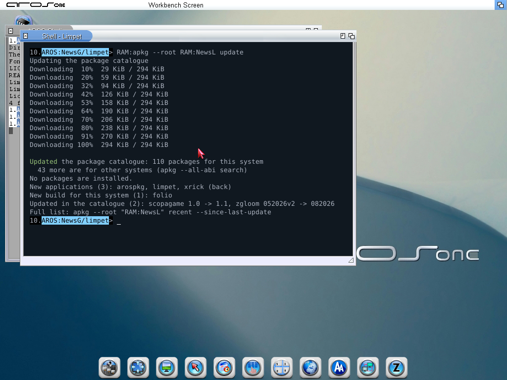
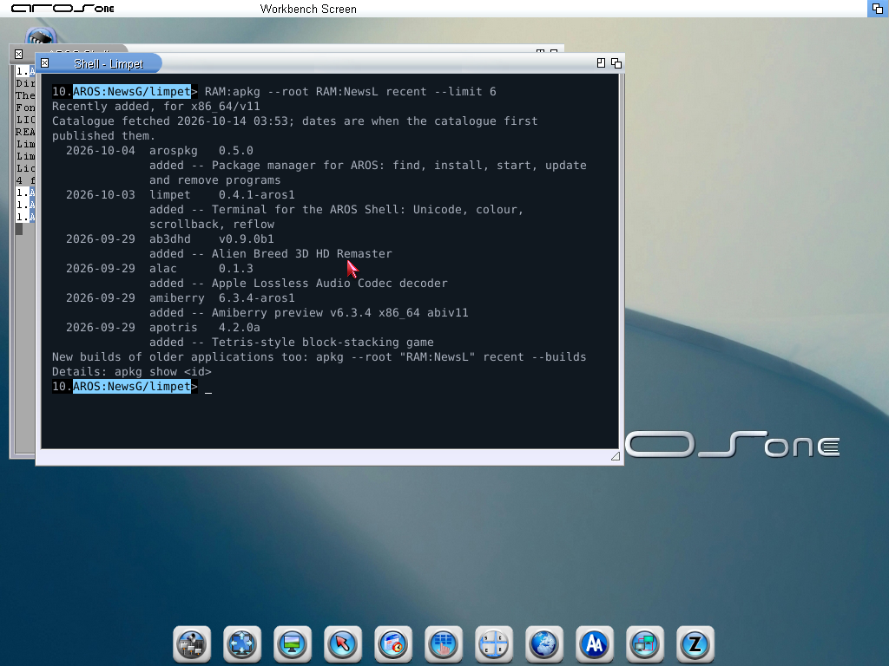
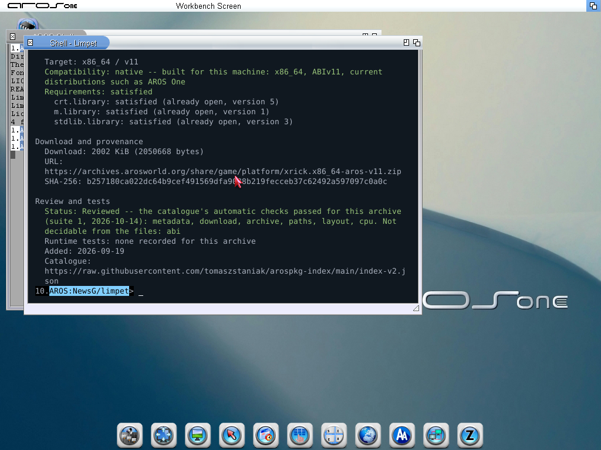

# arospkg 0.6 screenshots: what is new, Listed and Reviewed

From the development build of 2026-10-14 (apkg 309f3801..., PkgManager
732900c9...) on AROS One 1.3, x86_64 ABIv11, 1024x768. Terminal examples use
Limpet 0.4.1. These are working screenshots for the coming 0.6 release; the
release adds its own.

What is real and what was prepared:

- The catalogue fetched is the published one, from
  `raw.githubusercontent.com/tomaszstaniak/arospkg-index/main/index-v2.json`.
- The catalogue it replaced was prepared for the test: the published one
  without limpet, arospkg and xrick, without Folio's x86_64 build, and with
  older versions of scopagame and zgloom, recorded as fetched on
  2026-10-01. So the news shown is the difference between those two files,
  not a real week of the catalogue.

## PkgManager: after Update index

## Last refresh, with a build's status, runtime tests and dates

## Recently added

## Limpet: apkg update, apkg recent, apkg show

