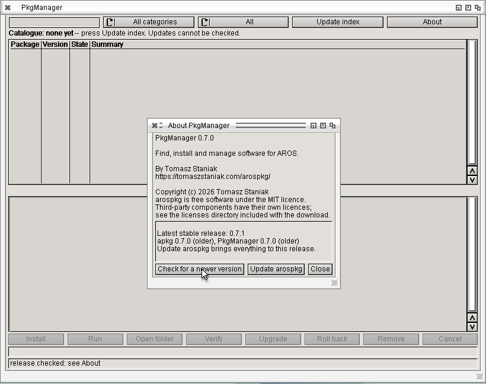
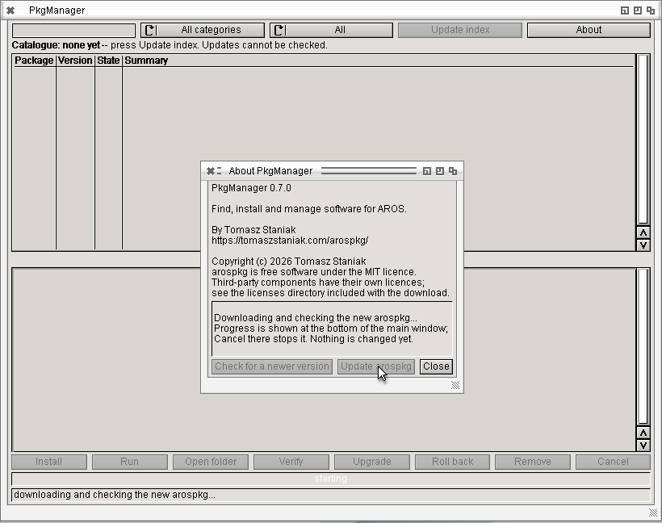
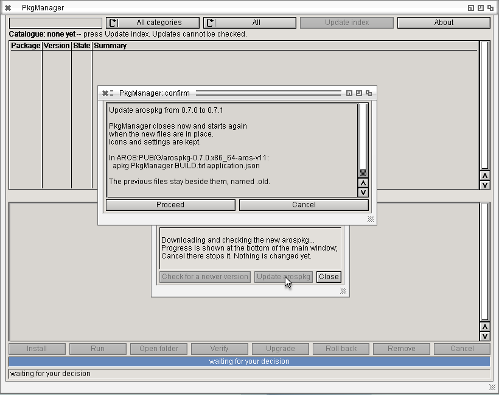
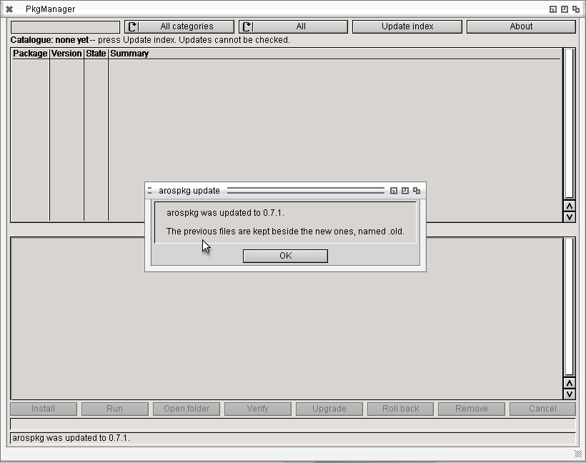
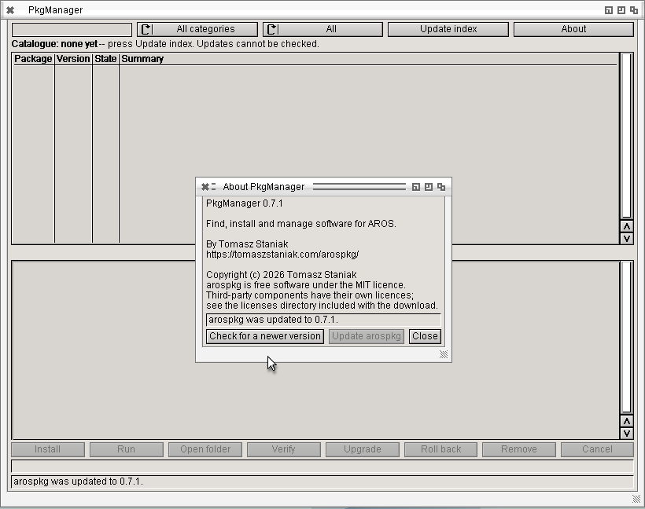

# Updating arospkg from PkgManager (0.7.1)

PkgManager 0.7.0 updating itself and its apkg to 0.7.1 from the published
release, on AROS 2026.09, x86_64 ABIv11, 1024x768. The 0.7.0 archive was
unpacked by hand into a drawer and PkgManager started from there.

**About** > **Check for a newer version**: the latest stable release is
0.7.1, and both apkg and PkgManager in this drawer are older.

**Update arospkg** downloads and checks the release while the main window
keeps responding. Nothing is changed yet; **Cancel** at the bottom stops it.

What will be replaced, and where. PkgManager closes and starts again.

PkgManager started again by itself, with the same package root, and says
what happened. The previous files stay beside the new ones as `.old`.

About now shows PkgManager 0.7.1.

See [Updating arospkg](../../self-update.md).
