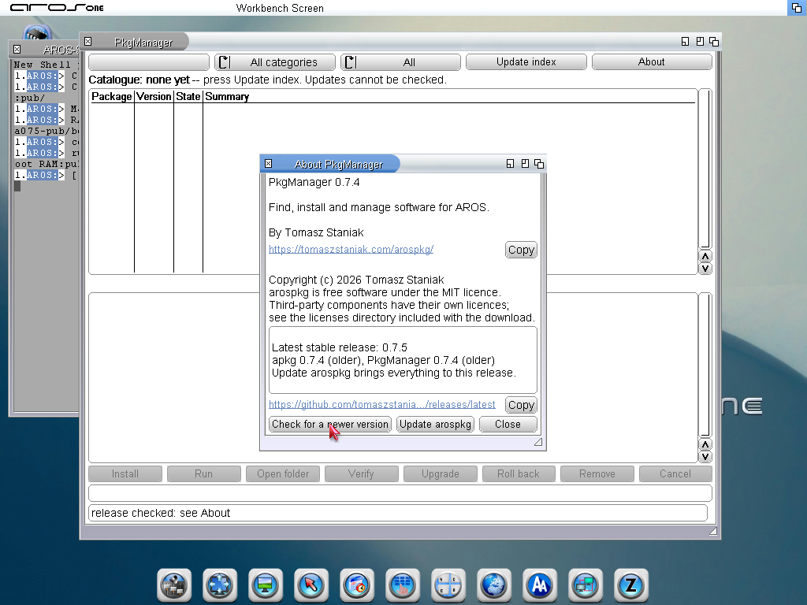
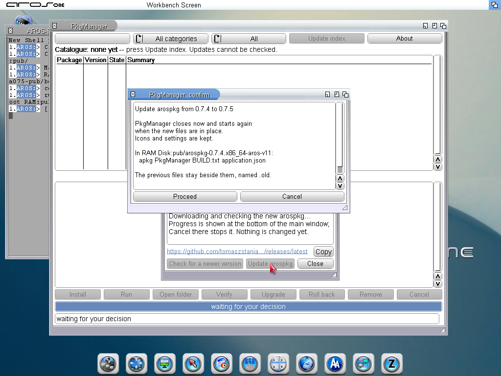
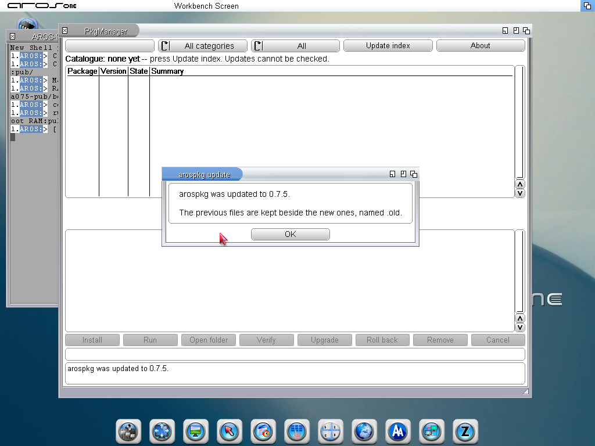
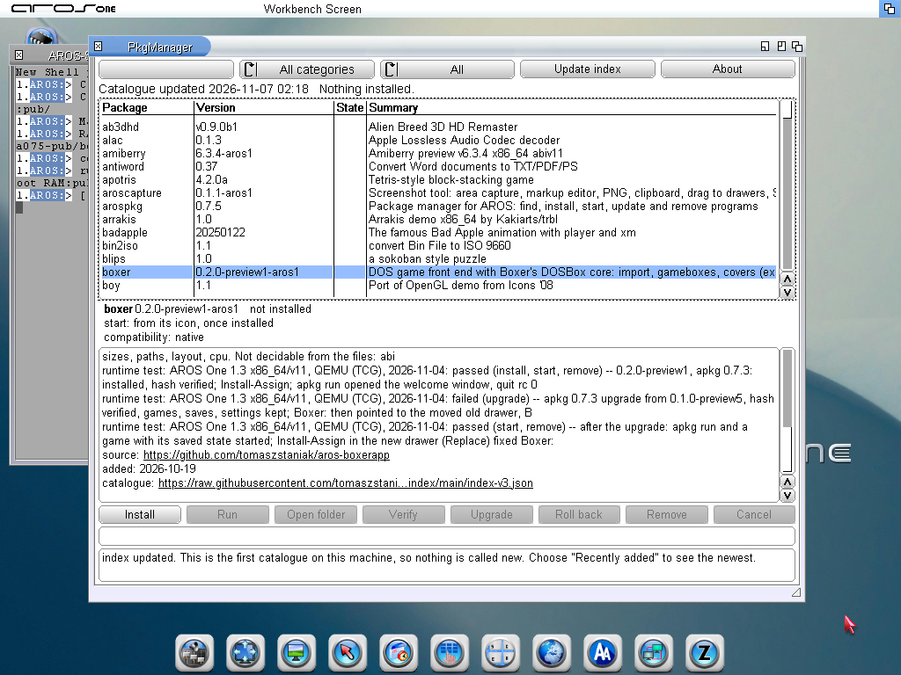
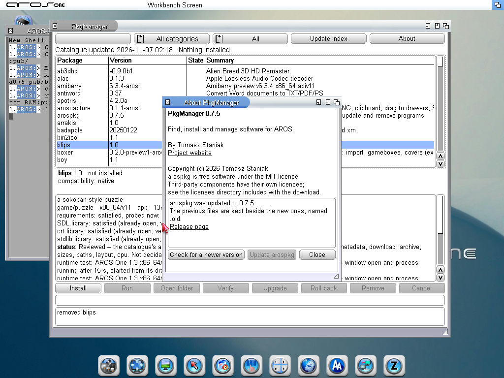
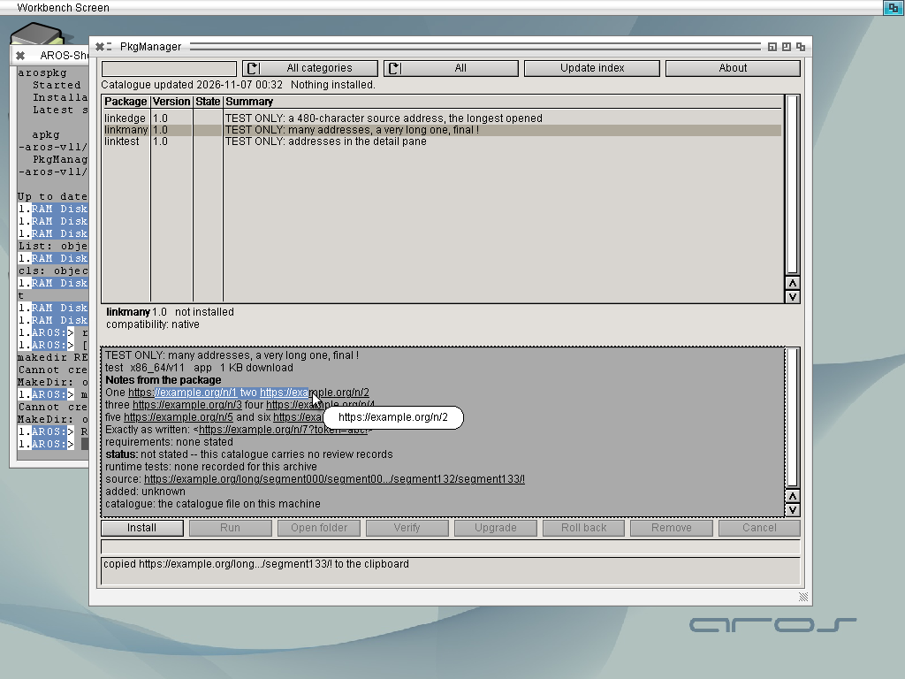

# arospkg 0.7.5 on AROS One 1.3

PkgManager 0.7.4 updating itself and its apkg to 0.7.5 from the published
release, then 0.7.5 with the public catalogue, on AROS One 1.3, x86_64
ABIv11, 1024x768. The 0.7.4 archive was unpacked by hand into a drawer and
PkgManager started from there.

The last picture is from AROS 2026.09 with the hand-written test catalogue
`tests/links/links-index.json`: text selected by dragging across two links
opens nothing, and the bubble shows the full address under the pointer.

